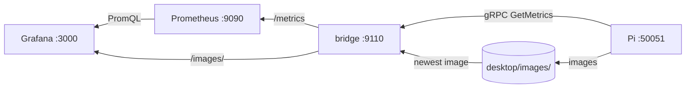

# cs244-dashboard

```
Directory Tree with summary

├── README.md
├── desktop (Dashboard Setup)
│   ├── bridge (bridge between desktop and pi / utilizes grpc)
│   ├── docker-compose.yml
│   ├── grafana (Frontend Service for visualization)
│   ├── images (storage for images received)
│   ├── prometheus (tsdb, data scraping from bridge)
│   │   └── prometheus.yml
│   └── run.sh
├── pi (Raspberry Pi Setup)
│   ├── pyproject.toml (uv - depedency management)
│   ├── server.py
│   ├── start.sh
├── proto
│   └── pimonitor.proto

```

## Data flow (w/ mermaid)



### One scrape cycle

1. Prometheus requests `GET /metrics` from the bridge every 5 seconds.
2. The bridge calls `GetMetrics` on each Pi in `PI_TARGETS` (comma-separated `host:port`).
3. On the Pi, `server.py` runs every collector (`cpu_temp`, `throttling`, `cpu_usage`, `memory`) and returns a `GetMetricsResponse` (contract in `proto/pimonitor.proto`).
4. The bridge renders each metric as `rpi_<name>{pi, target, ...labels}` in Prometheus text format, plus `rpi_up{target}` (1 if the call succeeded, 0 if not).
5. Grafana queries Prometheus with PromQL to draw the panels.
